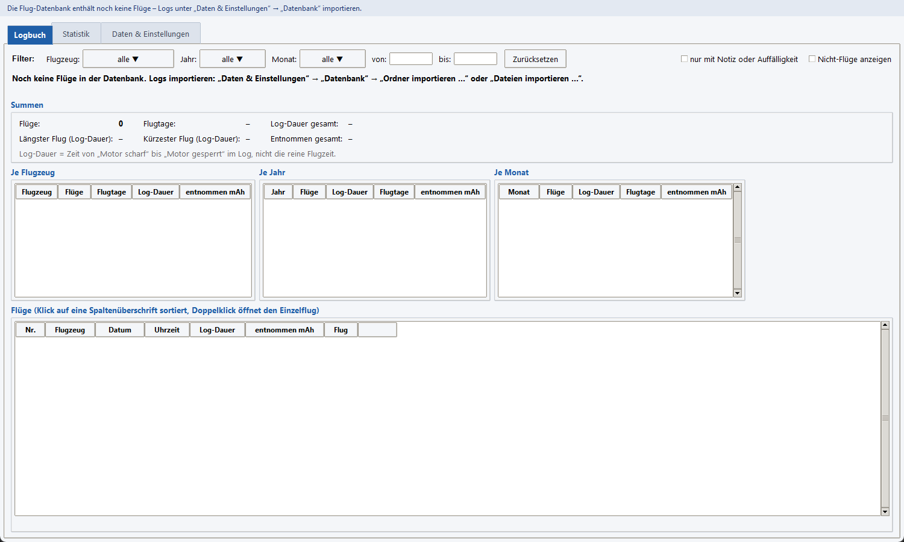
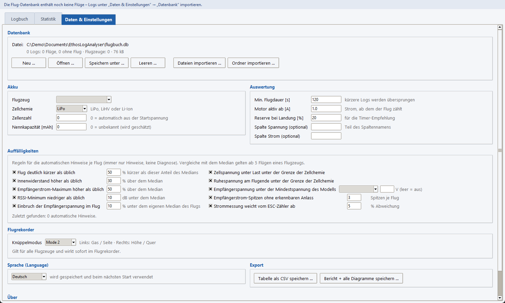
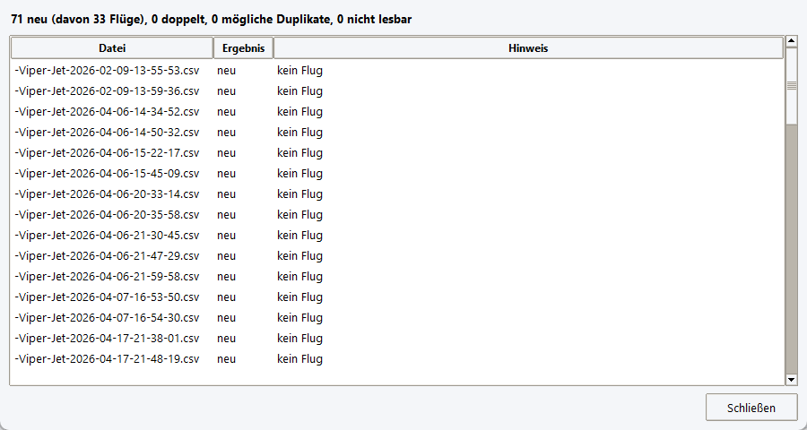
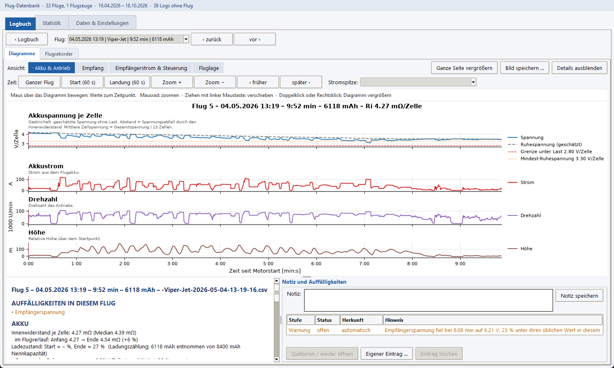
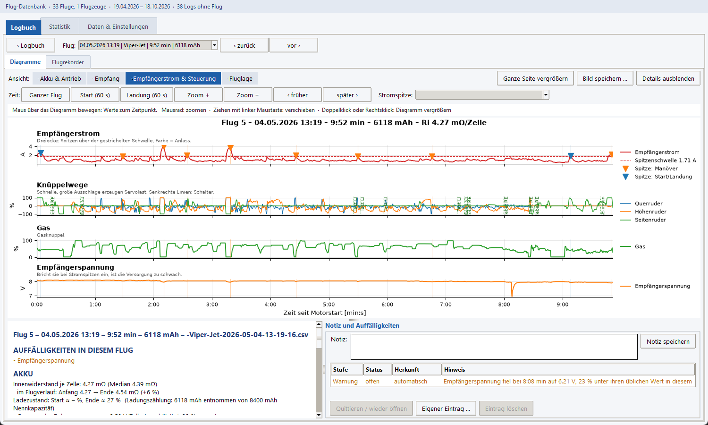
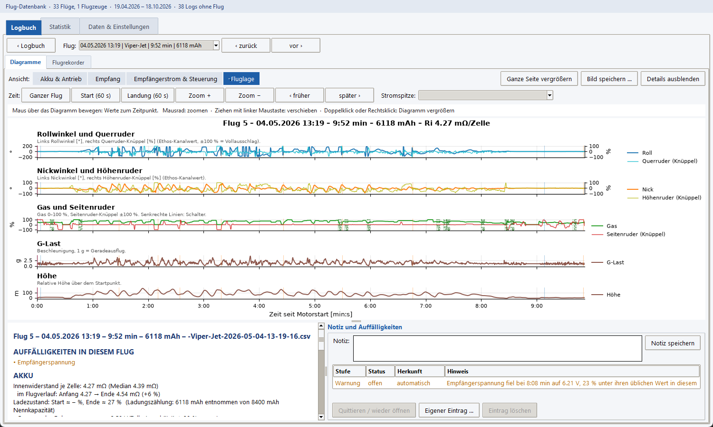
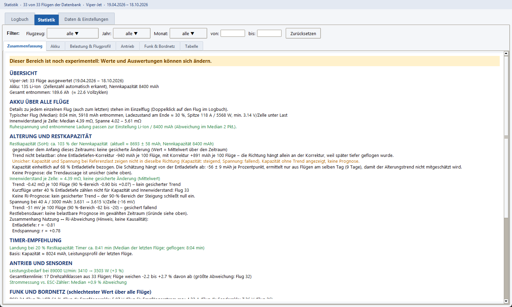
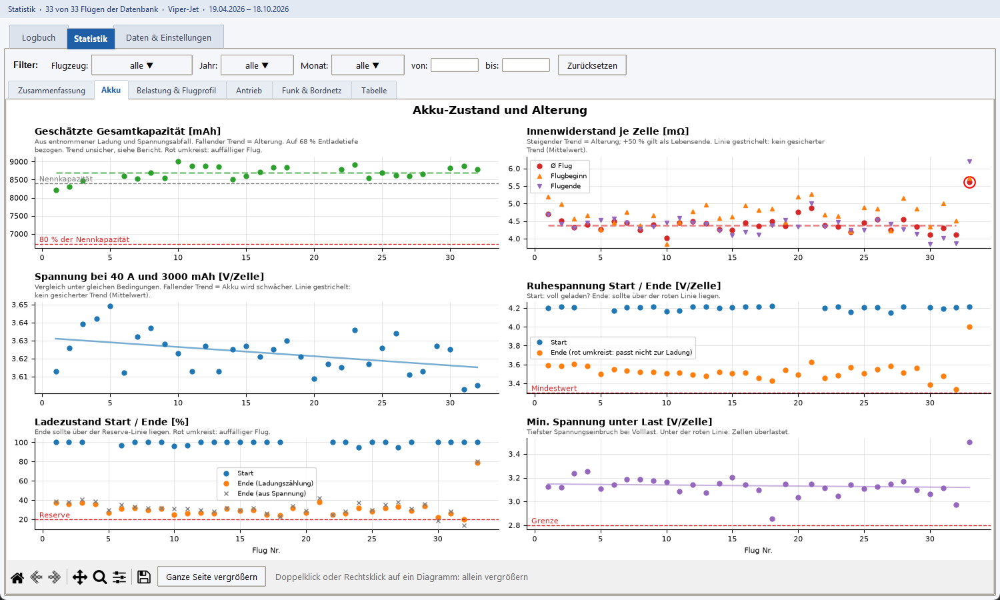
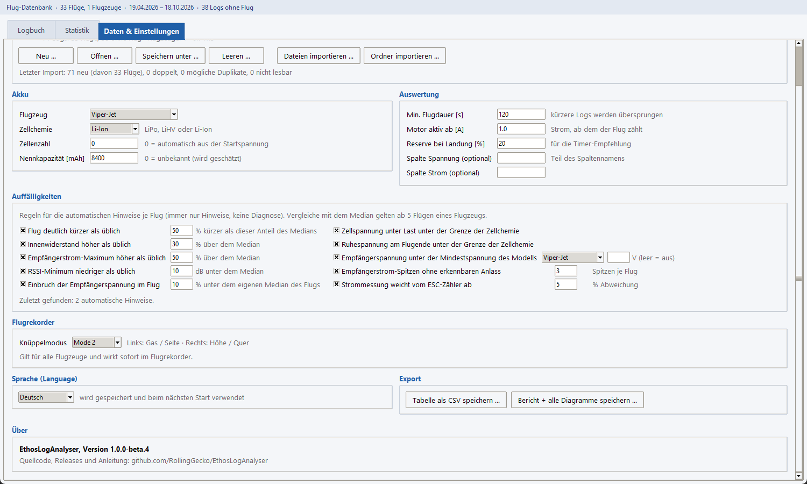

# EthosLogAnalyser – Anleitung

Für Piloten, die die Windows-EXE nutzen. Version: 1.0.0 Beta 4 (Vorabversion). Programmierkenntnisse sind nicht nötig.
Englische Fassung: [user-guide_en.md](user-guide_en.md).

EthosLogAnalyser liest die Flugprotokolle (CSV-Dateien), die dein **FrSky-Ethos**-Sender schreibt, und macht daraus ein
**Logbuch** deiner Flüge, **Diagramme** zu jedem Flug, einen **Flugrekorder**, der einen Flug abspielt, und
**Statistiken** zu Akkus und Modell. Alle Daten bleiben auf deinem Computer; deine Log-Dateien werden nie verändert.

Die Screenshots zeigen die deutsche Oberfläche. Das Programm spricht auch Englisch und Spanisch (siehe
[Sprache](#7-daten--einstellungen)).

## Inhalt

1. [Installieren und starten](#1-installieren-und-starten)
2. [Erste Schritte: Logs importieren](#2-erste-schritte-logs-importieren)
3. [Logbuch](#3-logbuch)
4. [Einzelflug: Diagramme](#4-einzelflug-diagramme)
5. [Flugrekorder](#5-flugrekorder)
6. [Statistik](#6-statistik)
7. [Daten & Einstellungen](#7-daten--einstellungen)
8. [Notizen und Auffälligkeiten](#8-notizen-und-auffälligkeiten)
9. [Fragen und Probleme](#9-fragen-und-probleme)

---

## 1. Installieren und starten

Es gibt keinen Installer. Lade die `.exe` der neuesten Version von der
[Releases-Seite](https://github.com/RollingGecko/EthosLogAnalyser/releases) herunter (eine Beta ist als *Pre-release*
markiert), lege sie in einen beliebigen Ordner und starte sie mit Doppelklick.

Windows zeigt eventuell eine blaue **SmartScreen**-Warnung, weil die Datei nicht signiert ist: **Weitere Informationen →
Trotzdem ausführen**.

Beim ersten Start legt das Programm seine Flug-Datenbank unter `Dokumente\EthosLogAnalyser\flugbuch.db` an und merkt
sich deine Einstellungen. Sonst wird nichts installiert. Das Programm ist eine **Beta**: Bitte melde alles, was
falsch aussieht.

## 2. Erste Schritte: Logs importieren

Nach dem ersten Start ist das Programm leer:

1. **Logs besorgen.** Die Ethos-Logs sind CSV-Dateien auf der SD-Karte deines Senders, benannt wie
   `Viper-Jet-2026-04-19-13-25-36.csv`: Der Teil vor dem Datum ist der **Modellname**, das Programm nutzt ihn als
   **Flugzeug**. Kopiere sie auf den PC oder nutze die SD-Karte direkt. (Ein Log enthält nur die Werte, die in Ethos
   unter *Logging* ausgewählt sind.)
2. Öffne den Reiter **Daten & Einstellungen**. Oben steht der Bereich **Datenbank**:

   

3. Klicke auf **Ordner importieren …** und wähle den Ordner mit deinen Logs (Unterordner werden mitgenommen) – oder auf
   **Dateien importieren …** für einzelne Dateien. Ein Fortschrittsbalken zeigt den Import; bei einigen Dutzend Logs
   dauert er wenige Sekunden.
4. Der **Import-Bericht** listet jede Datei auf:

   

   | Ergebnis | Bedeutung |
   |---|---|
   | *neu* | importiert |
   | *doppelt* | gleicher Inhalt ist schon da (auch unter anderem Dateinamen) – übersprungen |
   | *mögliches Duplikat* | gleiches Flugzeug und gleiche Startzeit, anderer Inhalt – importiert und mit ⚠ markiert |
   | *nicht lesbar* | kein Ethos-Log oder Spalten fehlen – der Grund steht dabei |

   Jedes Log wird gespeichert, aber nur echte Flüge zählen: kurze Motorläufe und Bodenlogs sind als *kein Flug*
   markiert (die Hinweis-Spalte sagt es). Die Entscheidung kannst du später im Logbuch ändern.
5. **Akku eintragen** (einmal je Flugzeug). Nach dem Import erscheint unter den Akku-Feldern ein roter Hinweis:

   

   Wähle das Flugzeug, die **Zellchemie** (LiPo, LiHV, Li-Ion) und trage die **Nennkapazität** in mAh ein. Der Hinweis
   verschwindet. Ohne diese Angaben nimmt das Programm LiPo und unbekannte Kapazität an; Ladezustand und
   Akku-Alterung können dann falsch sein.

Neue Logs kannst du jederzeit nachimportieren – dieselbe Datei wird nie doppelt gezählt.

## 3. Logbuch

Der Reiter **Logbuch** ist die Startseite: ein Überblick über dein Fliegen.

Von oben nach unten:

- **Filter**: nur bestimmte **Flugzeuge**, **Jahre** oder **Monate** zeigen, oder einen Zeitraum (*von / bis*, als
  TT.MM.JJJJ). Ein Klick auf ein Feld öffnet eine Liste, in der du mehrere Werte anhaken kannst; **Zurücksetzen**
  entfernt den Filter. Der Filter gilt auch für die Statistik.
- **Summen**: Anzahl Flüge, Flugtage, Log-Dauer gesamt, längster und kürzester Flug, insgesamt entnommene Ladung.
- **Je Flugzeug / Je Jahr / Je Monat**: dieselben Zahlen, aufgeteilt.
- **Flugliste**: jeder Flug mit Nummer, Flugzeug, Datum, Uhrzeit, Dauer und entnommenen mAh. Ein Klick auf eine
  Spaltenüberschrift sortiert (nochmal klicken kehrt um). **Doppelklick auf einen Flug öffnet ihn** (Abschnitt 4).

Gut zu wissen:

- *Log-Dauer* ist die Zeit von „Motor scharf“ bis „Motor gesperrt“, nicht die reine Flugzeit. Die Flugnummern zählen je
  Flugzeug, der älteste Flug ist Nr. 1.
- **Nicht-Flüge anzeigen** listet auch Logs, die nicht als Flug erkannt wurden (grau). In der Spalte **Flug** ändert ein
  Klick auf ☑ / ☐ die Entscheidung. Ein selbst gesetztes ☑ bleibt auch nach einem neuen Import erhalten.
- **nur mit Notiz oder Auffälligkeit** zeigt nur Flüge mit Notiz oder offenem Hinweis (Abschnitt 8). Die letzte Spalte
  zeigt ✎ für eine Notiz, ℹ / ⚠ / ‼ für Hinweise steigender Schwere und ⚠ für ein mögliches Duplikat.

## 4. Einzelflug: Diagramme

Doppelklicke einen Flug im Logbuch. **‹ Logbuch** bringt dich zurück; **‹ zurück / vor ›** oder die Liste **Flug**
wechseln zu einem anderen Flug. Der Reiter **Diagramme** zeigt den Flug über der Zeit (*Zeit seit Motorstart*):

Wähle über die Knöpfe neben **Ansicht** eine Darstellung:

| Ansicht | Zeigt | Nutzen |
|---|---|---|
| Akku & Antrieb | Spannung je Zelle, Strom, Drehzahl, Höhe | sehen, wie stark der Akku unter Last einbricht |
| Empfang | Signalstärke (RSSI), Telemetrie-Frames (VFR), Höhe | Aussetzer der Funkstrecke finden |
| Empfängerstrom & Steuerung | Empfängerstrom mit Spitzen, Knüppelwege, Gas, Empfängerspannung | klären, ob Servolast die Empfängerversorgung einbrechen lässt |
| Fluglage | Roll, Nick, Gas und Seitenruder mit den Knüppeln, g-Last, Höhe | die Reaktion des Modells mit deinen Steuereingaben vergleichen |

Arbeiten mit den Diagrammen:

- **Maus über ein Diagramm bewegen**: die Zeile über den Diagrammen zeigt alle Werte zu diesem Zeitpunkt, eine senkrechte
  Linie markiert die Zeit in allen Diagrammen.
- **Mausrad** zoomt, **Ziehen** verschiebt. **Ganzer Flug** setzt zurück; **Start (60 s)** und **Landung (60 s)**
  springen zu diesen Abschnitten. **Stromspitze** springt zu einer kurzen Spitze des Empfängerstroms.
- **Doppelklick** auf ein Diagramm (oder Rechtsklick → *Dieses Diagramm vergrößern*) zeigt es im Vollbild; **Esc** schließt.
  **Ganze Seite vergrößern** macht das für alle Diagramme. **Bild speichern …** speichert die Seite als Bild.
- Unter den Diagrammen vergleichen die **Details** diesen Flug mit dem *Median aller Flüge desselben Flugzeugs*
  (Innenwiderstand, Ladezustand, Spitzenstrom und mehr). **Details ausblenden** gibt den Diagrammen mehr Platz.
  Der Bereich *Notiz und Auffälligkeiten* steht in Abschnitt 8.

Ein Log ohne Spannung und Strom des Flugakkus (z. B. ein Segler) hat keine Diagramme, lässt sich aber trotzdem im
Flugrekorder abspielen.

## 5. Flugrekorder

Der Reiter **Flugrekorder** spielt den gewählten Flug in Echtzeit ab, wie ein Cockpit:

- **Künstlicher Horizont** (Mitte): Roll und Nick des Modells. **Anzeigen**: Höhe, Steigen/Sinken, Antrieb (Drehzahl und
  Gas) und Akku (Strom und Spannung). Anzeigen für Sensoren, die das Log nicht hat, fehlen.
- **Sender** (unten rechts): die beiden Knüppel als Punkte mit den Werten in Prozent. Das Flugzeug daneben dreht sich mit
  der Fluglage und bewegt seine Ruder mit den Knüppeln. Es ist ein einfaches Modellbild, nicht dein eigenes Flugzeug.
- **Zeitleiste** (unten): Klicken oder Ziehen springt an jeden Moment. Das grüne Band zeigt, wo Telemetrie vorhanden ist.
- **Abspielen / Stopp**, **erste / vorige / nächste / letzte Zeile** und **Tempo** von 0,25× bis 16×. Tasten (erst in
  den Rekorder klicken): **Leertaste** Abspielen/Stopp, **← / →** eine Zeile, **Umschalt + ← / →** 10 s, **Pos1 / Ende**.
- Das Log hat etwa alle Viertelsekunde eine Zeile; das Bild springt von Zeile zu Zeile, es wird nicht geglättet. Für
  Details Tempo 0,25× oder die Einzelschritte nutzen.
- Der Rekorder spielt denselben Teil des Fluges wie die Diagramme: vom Motorstart bis zum Motorstopp.

Rekorder und Diagramme sind verbunden. Im Reiter **Diagramme** zeigt eine dünne rosa **senkrechte Linie**, wo der Rekorder
steht, und ein **Klick** in ein Diagramm setzt ihn dorthin:

So kannst du im Rekorder an einem interessanten Moment anhalten und die anderen Kurven ablesen – oder umgekehrt.

**Knüppelmodus:** Die Knüppel werden für den Modus gezeichnet, der unter *Daten & Einstellungen → Flugrekorder* eingestellt
ist (Standard: Mode 2). Ändere ihn, wenn dein Gas auf dem anderen Knüppel liegt.

*Beta-Hinweis:* Die Richtung von Roll und Nick in Horizont und Flugzeug wird noch an bekannten Flugfiguren geprüft. Wenn
ein Modell falsch herum rollt, melde es bitte.

## 6. Statistik

Der Reiter **Statistik** betrachtet **viele Flüge eines Flugzeugs** auf einmal, z. B. wie dein Akku altert. Er hat denselben
**Filter** wie das Logbuch. Sind mehrere Flugzeuge gewählt, bittet das Programm um **eines** – Flugzeuge werden nie
vermischt. Diese Seiten sind noch als *experimentell* gekennzeichnet: Die Zahlen sind Schätzungen, nimm sie als Hinweise.

Die kleineren Reiter darin:

| Seite | Zeigt |
|---|---|
| **Zusammenfassung** | alle Ergebnisse als Text: Akku-Zustand, Alterung und Restkapazität, Timer-Empfehlung, Antrieb, Funk und Warnungen |
| **Akku** | geschätzte Kapazität, Innenwiderstand je Zelle, Spannung bei fester Referenzlast, Ruhespannung, Ladezustand – ein Punkt je Flug, mit Trendlinien |
| **Belastung & Flugprofil** | Gas-Histogramm, C-Rate, Energie je Flugphase, Spitzenleistung, g-Kräfte, Flugzeit gegen Timer |
| **Antrieb** | Leistung über Drehzahl, Leistungsbedarf bei Referenzdrehzahl, Stromsensor gegen ESC-Zähler |
| **Funk & Bordnetz** | RSSI, Telemetrie-Frames, Empfänger- und Senderakku, Empfängerstrom und seine Spitzen, nach Anlass sortiert |
| **Tabelle** | alle Kennzahlen jedes Fluges als Tabelle |

So liest du sie:

- **Rote Kreise** markieren ungewöhnliche Flüge. Ein steigender Innenwiderstand (+50 % gilt als Ende der Akku-Lebensdauer)
  oder eine fallende Kapazität deutet auf Alterung hin. Eine gestrichelte Linie heißt „noch kein verlässlicher Trend“.
- Die **Timer-Empfehlung** ist die Flugzeit, nach der noch etwa 20 % der Kapazität übrig sind (änderbar unter
  *Daten & Einstellungen → Auswertung*).
- Die Statistik wird mit mehr Flügen und eingetragener **Nennkapazität** verlässlicher.
- Die Diagramme funktionieren wie im Einzelflug: Maus drüber für Werte, Doppelklick vergrößert ein Diagramm,
  **Ganze Seite vergrößern** zeigt alle.

Die **Tabelle** und der Export (Abschnitt 7) sind für deine eigene Tabellenkalkulation gedacht:

Alles, was das Programm zeigt, sind **Hinweise und Schätzungen, keine Diagnose**. Ein auffälliger Wert ist ein Grund, Akku,
Kabel oder Empfängerversorgung anzusehen – kein Beweis für einen Defekt.

## 7. Daten & Einstellungen

Der dritte Reiter enthält alles, was du einmal einrichtest:

| Bereich | Wofür |
|---|---|
| **Datenbank** | Flug-Datenbank **Neu / Öffnen / Speichern unter / Leeren** (eine normale Datei – kopiere sie als Sicherung deines Logbuchs oder für einen anderen PC) und die Importe. *Leeren* entfernt die Logs nur aus der Datenbank; deine CSV-Dateien bleiben unberührt. |
| **Akku** | je Flugzeug: Zellchemie, Zellenzahl (0 = aus der Startspannung erkennen), Nennkapazität (0 = unbekannt, wird geschätzt). |
| **Auswertung** | *Min. Flugdauer* (kürzere Logs sind keine Flüge, Standard 120 s), *Motor aktiv ab* (Strom, ab dem ein Flug zählt, Standard 1 A), *Reserve bei Landung* (für die Timer-Empfehlung, Standard 20 %). Die beiden Spaltenfelder braucht man nur, wenn das Programm die falsche Spannungs- oder Stromspalte wählt. |
| **Auffälligkeiten** | die automatischen Hinweise (Abschnitt 8) ein- oder ausschalten und ihre Grenzen ändern. |
| **Flugrekorder** | Knüppelmodus 1–4. |
| **Sprache (Language)** | Deutsch, English, Español; das Fenster wechselt sofort, die Wahl wird gemerkt. Beim ersten Start gilt die Systemsprache, falls unterstützt. |
| **Export** | **Tabelle als CSV speichern** (öffnet in Excel; Semikolon-getrennt) und **Bericht + alle Diagramme speichern** (Textbericht und alle Diagramme als Bilder in einen Ordner). Beide nutzen die Flüge des aktuellen Statistik-Filters. |
| **Über** | Version und Link zur Projektseite. |

Die Einstellungen werden automatisch in `.akku_analyse.json` in deinem Benutzerordner gespeichert.

## 8. Notizen und Auffälligkeiten

Jeder Flug kann eine **Notiz** und **Auffälligkeiten** tragen. Beides steht im Einzelflug unter den Diagrammen (*Notiz und
Auffälligkeiten*):

- **Notiz**: freier Text, z. B. „neuer Propeller“ oder „harte Landung“. Klicke auf **Notiz speichern** (sie wird auch
  gespeichert, wenn du den Flug verlässt).
- **Auffälligkeiten** sind Hinweise. Das Programm erzeugt sie nach Regeln, z. B. „Flug deutlich kürzer als üblich“,
  „Innenwiderstand höher als üblich“, „Einbruch der Empfängerspannung“ oder „Empfängerstrom-Spitzen ohne erkennbaren
  Anlass“. Jede hat eine Stufe (**Info, Warnung, Kritisch**), einen Status (*offen / quittiert*) und eine Herkunft
  (*automatisch / eigener Eintrag*).
  - **Quittieren / wieder öffnen** markiert einen Hinweis als erledigt.
  - **Eigener Eintrag …** fügt einen eigenen Hinweis mit Stufe hinzu; **Eintrag löschen** entfernt eigene Einträge
    (automatische lassen sich nur quittieren).
- Im Logbuch zeigt die letzte Spalte, welche Flüge eine Notiz oder offene Hinweise haben; **nur mit Notiz oder
  Auffälligkeit** listet genau diese.
- Regeln und Grenzen stehen unter *Daten & Einstellungen → Auffälligkeiten*. Vergleiche mit dem „üblichen“ Wert brauchen
  mindestens 5 Flüge des Flugzeugs.

## 9. Fragen und Probleme

| Problem | Was tun |
|---|---|
| Das Logbuch ist leer | Logs importieren (Abschnitt 2). Logs, die als *kein Flug* gelten, sind ausgeblendet: **Nicht-Flüge anzeigen** anhaken. |
| Ein Flug fehlt | Import-Bericht prüfen. Kurze Logs (unter 120 s) und Bodenlogs sind keine Flüge; im Logbuch **☑** setzen, falls es einer war, oder *Min. Flugdauer* senken und nach *Leeren …* neu importieren. |
| „Bitte im Filter ein Flugzeug wählen“ | Die Statistik braucht genau ein Flugzeug: im Filter **Flugzeug** eines anhaken. |
| Roter Akku-Hinweis | Zellchemie wählen und Nennkapazität für das Flugzeug eintragen (Abschnitt 2). |
| Ein Flug hat keine Diagramme | Das Log enthält keine Spannung und keinen Strom des Flugakkus. Der Flugrekorder funktioniert trotzdem. |
| Eine Anzeige im Rekorder fehlt oder zeigt „—“ | Das Log hat den Sensor nicht, oder sein letzter Wert ist älter als 2 s. |
| Diagramme wirken gedrängt | Das Fenster größer ziehen. Windows-Skalierung von 100–150 % wird unterstützt. |
| Etwas sieht falsch aus | Flug und Vorgehen notieren und auf der Projektseite melden: [github.com/RollingGecko/EthosLogAnalyser](https://github.com/RollingGecko/EthosLogAnalyser). |

Mehr Details für Neugierige (auf Englisch): [Usage](usage.md) · [Methodology](methodology.md) (wie die Zahlen berechnet
werden) · [Ethos log format](ethos-log-format.md).
