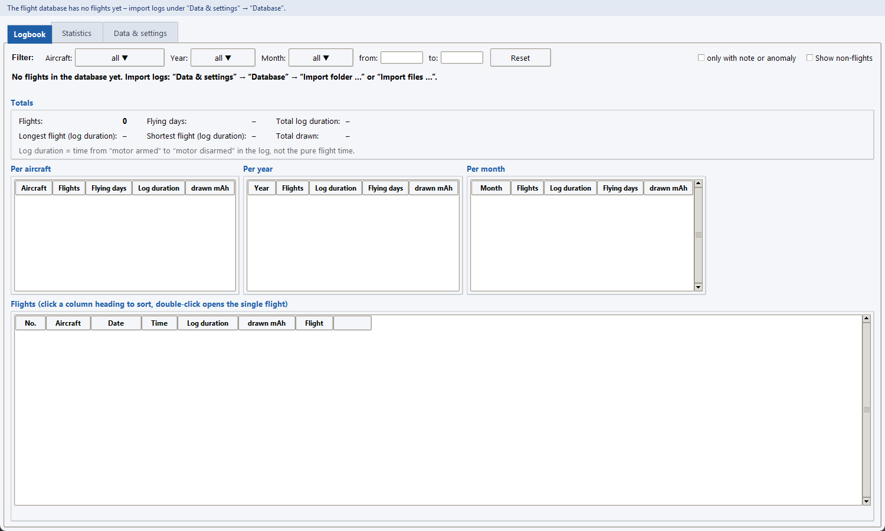
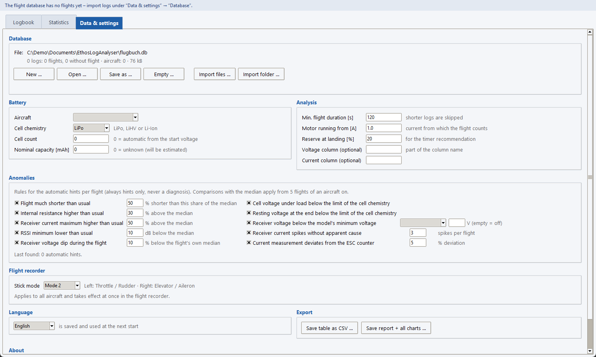
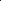
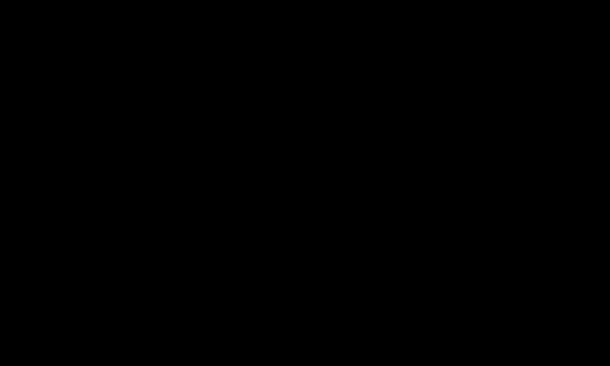
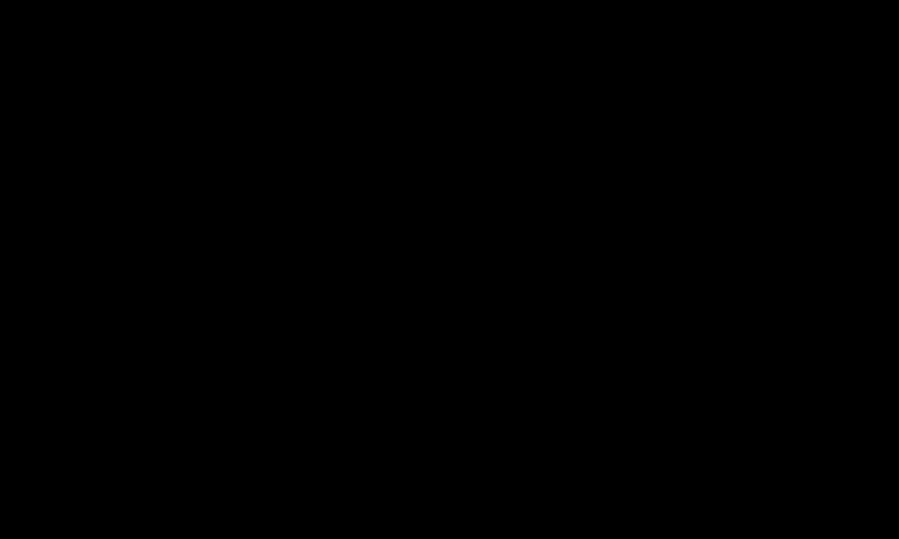
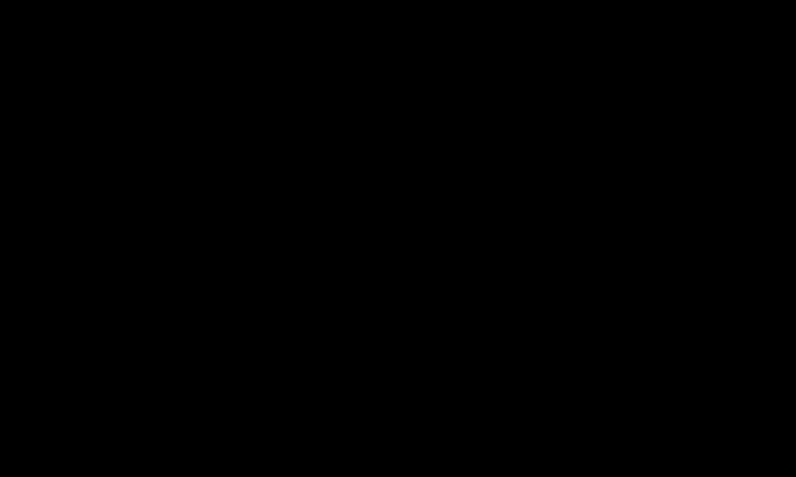
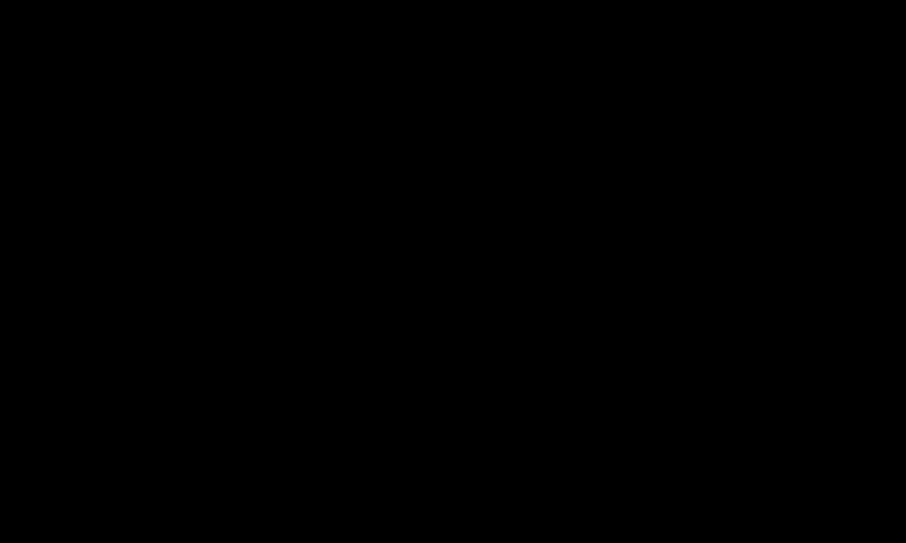

# EthosLogAnalyser – User guide

For pilots who use the Windows EXE. Version: 1.0.0 beta 3 (pre-release). No programming knowledge needed.
German version: [user-guide_de.md](user-guide_de.md).

EthosLogAnalyser reads the flight logs (CSV files) that your **FrSky Ethos** transmitter writes and turns them into
a **logbook** of your flights, **charts** of every flight, a **flight recorder** that replays a flight, and
**statistics** about your batteries and your model. All data stays on your computer; your log files are never changed.

The screenshots show the English interface. The program also speaks German and Spanish (see [Language](#7-language)).

## Contents

1. [Install and start](#1-install-and-start)
2. [First steps: import your logs](#2-first-steps-import-your-logs)
3. [Logbook](#3-logbook)
4. [Single flight: charts](#4-single-flight-charts)
5. [Flight recorder](#5-flight-recorder)
6. [Statistics](#6-statistics)
7. [Data & settings](#7-data--settings)
8. [Notes and anomalies](#8-notes-and-anomalies)
9. [Questions and problems](#9-questions-and-problems)

---

## 1. Install and start

There is no installer. Download the `.exe` of the newest release from the
[Releases page](https://github.com/RollingGecko/EthosLogAnalyser/releases) (a beta is marked *Pre-release*), put it
in any folder and double-click it.

Windows may show a blue **SmartScreen** warning because the file is not signed: click **More info → Run anyway**.

On the first start the program creates its flight database in `Documents\EthosLogAnalyser\flugbuch.db` and remembers
your settings. Nothing else is installed. The program is a **beta**: please report anything that looks wrong.

## 2. First steps: import your logs

After the first start the program is empty:

1. **Get the logs.** The Ethos logs are CSV files on the SD card of your transmitter, named like
   `Viper-Jet-2026-04-19-13-25-36.csv`: the part before the date is the **model name**, the program uses it as
   the **aircraft**. Copy them to your PC, or use the SD card directly. (Logs only contain the values that are
   selected under *Logging* in Ethos.)
2. Open the tab **Data & settings**. The section **Database** is at the top:

   

3. Click **Import folder …** and choose the folder with your logs (subfolders are included) – or **Import files …**
   for single files. A progress bar shows the import; it takes a few seconds for dozens of logs.
4. The **import report** lists every file:

   

   | Result | Meaning |
   |---|---|
   | *new* | imported |
   | *duplicate* | the same content is already there (also under another file name) – skipped |
   | *possible duplicate* | same aircraft and start time, other content – imported and marked with ⚠ |
   | *unreadable* | not an Ethos log or columns missing – the reason is shown |

   Every log is stored, but only real flights count: short motor tests and ground logs are marked *not a flight*
   (the note column says so). You can change that decision later in the logbook.
5. **Tell the program about your battery** (once per aircraft). After the import a red hint appears below the
   battery fields:

   

   Choose the aircraft, the **cell chemistry** (LiPo, LiHV, Li-Ion) and enter the **nominal capacity** in mAh. The
   hint disappears. Without this the program assumes LiPo and an unknown capacity, so state of charge and battery
   ageing can be wrong.

You can import new logs at any time – the same file is never counted twice.

## 3. Logbook

The tab **Logbook** is the start page: an overview of your flying.

From top to bottom:

- **Filter**: show only some **aircraft**, **years** or **months**, or a date range (*from / to*, as dd.mm.yyyy).
  Click a field to open a list and tick several values; **Reset** removes the filter. The filter is shared with the
  statistics.
- **Totals**: number of flights, flying days, total log duration, longest and shortest flight, total drawn charge.
- **Per aircraft / per year / per month**: the same numbers, split up.
- **Flight list**: every flight with number, aircraft, date, time, duration and drawn mAh. Click a column heading to
  sort (click again to reverse). **Double-click a flight to open it** (section 4).

Good to know:

- *Log duration* is the time from “motor armed” to “motor disarmed”, not the pure airborne time. Flight numbers count
  per aircraft, oldest first.
- **Show non-flights** also lists logs that were not recognised as flights (grey). In the column **Flight**, a click on
  ☑ / ☐ changes the decision. A ☑ that you set yourself stays even after a new import.
- **only with note or anomaly** lists only flights with a note or an open hint (section 8). The last column shows ✎
  for a note, ℹ / ⚠ / ‼ for hints of rising severity, and ⚠ for a possible duplicate.

## 4. Single flight: charts

Double-click a flight in the logbook. **‹ Logbook** takes you back; **‹ previous / next ›** or the **Flight** list
switch to another flight. The tab **Charts** shows the flight over time (*Time since motor start*):

Choose a **view** with the buttons above the charts:

| View | Shows | Use it to |
|---|---|---|
| Battery & drive | voltage per cell, current, RPM, altitude | see how deep the battery sags under load |
| Reception | signal strength (RSSI), telemetry frames (VFR), altitude | find dropouts in the radio link |
| Receiver current & controls | receiver current with spikes, stick travel, throttle, receiver voltage | find out whether servo load makes the receiver supply dip |
| Attitude | roll, pitch, throttle and rudder with the sticks, g-load, altitude | compare the model's reaction with your stick input |

Working with the charts:

- **Move the mouse** over a chart: the line above the charts shows all values at that moment, a vertical line marks
  the time in every chart.
- **Mouse wheel** zooms, **dragging** moves the view. **Whole flight** resets; **Take-off (60 s)** and **Landing
  (60 s)** jump to those parts. **Current spike** jumps to a short peak of the receiver current.
- **Double-click** a chart (or right-click → *Enlarge this chart*) shows it full screen; **Esc** closes it.
  **Enlarge whole page** does the same for all charts. **Save image …** saves the page as a picture.
- Below the charts the **details** compare this flight with the *median of all flights of the same aircraft*
  (internal resistance, state of charge, peak current and more). **Hide details** gives the charts more room.
  The section *Note and anomalies* is explained in section 8.

A log without the voltage and current of the flight battery (for example a glider) has no charts, but it can still be
replayed in the flight recorder.

## 5. Flight recorder

The tab **Flight recorder** replays the selected flight in real time like a cockpit:

- **Artificial horizon** (middle): bank and pitch of the model. **Gauges**: altitude, vertical speed, drive (RPM and
  throttle) and battery (current and voltage). Gauges for sensors the log does not have are left out.
- **Radio** (bottom right): the two sticks as dots with the values in percent. The aircraft next to it turns with
  the attitude and moves its control surfaces with the sticks. It is a simple model picture, not your own aircraft.
- **Timeline** (bottom): click or drag to jump to any moment. The green band shows where telemetry exists.
- **Play / Stop**, **first / previous / next / last row**, and **Speed** from 0.25× to 16×. Keys (click into the
  recorder first): **Space** play/stop, **← / →** one row, **Shift + ← / →** 10 s, **Home / End**.
- The log has about one row every quarter second; the picture jumps from row to row, there is no smoothing. Use 0.25×
  or the single steps to look at details.
- The recorder plays the same part of the flight as the charts: from motor start to motor stop.

Two things link the recorder and the charts. In the tab **Charts** a thin pink **vertical line** shows where the
recorder stopped, and a **click** into a chart moves it there:

That lets you stop at an interesting moment in the recorder and read the other curves, or the other way round.

**Stick mode:** the sticks are drawn for the stick mode set under *Data & settings → Flight recorder* (Mode 2 is the
default). Change it if your throttle sits on the other stick.

*Beta note:* the direction of roll and pitch in the horizon and the aircraft is still being checked against known
manoeuvres. If you see a model rolling the wrong way, please report it.

## 6. Statistics

The tab **Statistics** looks at **many flights of one aircraft** at once, for example how your battery ages. It has the
same **filter** as the logbook. If several aircraft are selected, the program asks you to pick **one** – aircraft are
never mixed. These pages are still marked *experimental*: the numbers are estimates, so treat them as hints.

The smaller tabs inside:

| Page | Shows |
|---|---|
| **Summary** | all findings in text: battery condition, ageing and remaining capacity, timer recommendation, drive, radio and warnings |
| **Battery** | estimated capacity, internal resistance per cell, voltage at a fixed reference load, resting voltage, state of charge – one dot per flight, with trend lines |
| **Load & flight profile** | throttle histogram, C-rate, energy per flight phase, peak power, g-forces, flight time against the timer |
| **Drive** | power against RPM, power demand at a reference RPM, current sensor against the ESC counter |
| **Radio & onboard power** | RSSI, telemetry frames, receiver and transmitter battery, receiver current and its spikes, sorted by cause |
| **Table** | all key figures of every flight as a table |

How to read them:

- **Red circles** mark unusual flights. A rising internal resistance (+50 % is considered the end of battery life) or a
  falling capacity points to ageing. A dashed line means “no reliable trend yet”.
- The **timer recommendation** is the flight time after which about 20 % of the capacity remains (changeable under
  *Data & settings → Analysis*).
- Statistics become more reliable with more flights and with the **nominal capacity** entered.
- Charts work like the charts of the single flight: hover for values, double-click to enlarge a chart,
  **Enlarge whole page** for all of them.

The **Table** page and the export (section 7) are meant for your own spreadsheet:

Everything the program shows are **hints and estimates, not a diagnosis**. A suspicious value is a reason to look at
the battery, the cables or the receiver supply – not proof of a defect.

## 7. Data & settings

The third tab holds everything you set up once:

| Section | What it is for |
|---|---|
| **Database** | **New / Open / Save as / Empty** the flight database (a normal file – copy it to back up your logbook or to move to another PC) and the imports. *Empty* removes the logs from the database only; your CSV files stay untouched. |
| **Battery** | per aircraft: cell chemistry, cell count (0 = detect from the start voltage), nominal capacity (0 = unknown, will be estimated). |
| **Analysis** | *Min. flight duration* (shorter logs are not flights, default 120 s), *Motor running from* (current from which a flight counts, default 1 A), *Reserve at landing* (for the timer recommendation, default 20 %). The two column fields are only needed if the program picks the wrong voltage or current column. |
| **Anomalies** | switch the automatic hints (section 8) on or off and change their limits. |
| **Flight recorder** | stick mode 1–4. |
| **Language** | Deutsch, English, Español; the window changes at once and the choice is remembered. At the first start the system language is used if supported. |
| **Export** | **Save table as CSV** (opens in Excel; semicolon-separated) and **Save report + all charts** (text report and all charts as pictures into a folder). Both use the flights of the current statistics filter. |
| **About** | version and link to the project page. |

Settings are saved automatically in `.akku_analyse.json` in your user folder.

## 8. Notes and anomalies

Every flight can carry a **note** and **anomalies**. Both are in the single flight, below the charts (*Note and
anomalies*):

- **Note**: free text, for example “new propeller” or “hard landing”. Click **Save note** (it is also saved when you
  leave the flight).
- **Anomalies** are hints. The program creates them by rules, for example “flight much shorter than usual”, “internal
  resistance higher than usual”, “receiver voltage dip” or “current spikes without apparent cause”. Each has a level
  (**Info, Warning, Critical**), a status (*open / acknowledged*) and an origin (*automatic / own entry*).
  - **Acknowledge / reopen** marks a hint as dealt with.
  - **Own entry …** adds your own hint with a level; **Delete entry** removes your own entries (automatic ones can only
    be acknowledged).
- In the logbook the last column shows which flights have a note or open hints, and **only with note or anomaly**
  lists just those.
- The rules and limits are under *Data & settings → Anomalies*. Comparisons with the “usual” value need at least
  5 flights of the aircraft.

## 9. Questions and problems

| Problem | What to do |
|---|---|
| The logbook is empty | Import logs (section 2). Logs counted as *not a flight* are hidden: tick **Show non-flights**. |
| A flight is missing | Check the import report. Short logs (under 120 s) and ground logs are not flights; tick **☑** in the logbook if it was one, or lower *Min. flight duration* and import again after *Empty …*. |
| “Please choose an aircraft in the filter” | The statistics need exactly one aircraft: tick one in the **Aircraft** filter. |
| Red battery hint | Choose cell chemistry and enter the nominal capacity for that aircraft (section 2). |
| A flight has no charts | The log has no voltage and current of the flight battery. The flight recorder still works. |
| A gauge in the recorder is missing or shows “—” | The log has no such sensor, or its last value is older than 2 s. |
| Charts look cramped | Make the window larger. Windows display scaling of 100–150 % is supported. |
| Something looks wrong | Note the flight and what you did, and report it on the project page: [github.com/RollingGecko/EthosLogAnalyser](https://github.com/RollingGecko/EthosLogAnalyser). |

More details for the curious: [Usage reference](usage.md) · [Methodology](methodology.md) (how the numbers are
calculated) · [Ethos log format](ethos-log-format.md).
